### Hi, I'm Pushpank

Design engineer in Raipur, India. I run [3Level](https://threelevel.in), a software company and design engineering studio, and build its products: [Betterdine](https://betterdine.me), [1morep](https://1morep.in), [Bookspine](https://bookspine.me), [Design Atlas](https://designatlas.in) and [GoodPick](https://goodpick.in).

[pushpank.me](https://pushpank.me) · [X](https://x.com/pushpank1010)

<!-- Stat cards: github.com/pedrocatalao/github-cool-readme, refreshed every 2 hours by .github/workflows/cool-readme.yml -->

<picture>
  <source media="(prefers-color-scheme: dark)" srcset="https://raw.githubusercontent.com/pushpank-dhruw/pushpank-dhruw/cards/summary-dark.svg">
  
</picture>
<picture>
  <source media="(prefers-color-scheme: dark)" srcset="https://raw.githubusercontent.com/pushpank-dhruw/pushpank-dhruw/cards/languages-dark.svg">
  
</picture>

<picture>
  <source media="(prefers-color-scheme: dark)" srcset="https://raw.githubusercontent.com/pushpank-dhruw/pushpank-dhruw/cards/weekly-dark.svg">
  
</picture>
<picture>
  <source media="(prefers-color-scheme: dark)" srcset="https://raw.githubusercontent.com/pushpank-dhruw/pushpank-dhruw/cards/streaks-dark.svg">
  
</picture>

