<!-- Stat cards: github.com/pedrocatalao/github-cool-readme, refreshed every 2 hours by .github/workflows/cool-readme.yml -->
<!-- Dot-matrix versions of these cards are built too (summary-*.svg, languages-*.svg, weekly-*.svg, streaks-*.svg on the cards branch); off the README for now. -->

<picture>
  <source media="(prefers-color-scheme: dark)" srcset="https://raw.githubusercontent.com/pushpank-dhruw/pushpank-dhruw/cards/classic-summary-dark.svg">
  
</picture>
<picture>
  <source media="(prefers-color-scheme: dark)" srcset="https://raw.githubusercontent.com/pushpank-dhruw/pushpank-dhruw/cards/classic-languages-dark.svg">
  
</picture>

<picture>
  <source media="(prefers-color-scheme: dark)" srcset="https://raw.githubusercontent.com/pushpank-dhruw/pushpank-dhruw/cards/classic-weekly-dark.svg">
  
</picture>
<picture>
  <source media="(prefers-color-scheme: dark)" srcset="https://raw.githubusercontent.com/pushpank-dhruw/pushpank-dhruw/cards/classic-streaks-dark.svg">
  
</picture>

